  

  

  

  
  
  
  

## 🖥️ `~/projects`

| Project | What it does | Tech | Links |
|---|---|---|---|
| 🧠 **Revio AI** | GenAI customer-review intelligence: sentiment, topics, urgency, recommended actions and reply drafts with human approval | FastAPI, Streamlit, Pydantic, Pandas, Grok (xAI) API | [Repo](https://github.com/luffyIGL010/revio-review-intelligence) |
| 🏋️ **AI Gym Coach** | Real-time pose tracking + AI feedback on exercise form | MediaPipe, OpenCV, Groq API, Streamlit | [Repo](https://github.com/luffyIGL010/Ai_gym_coach) · [Live](https://aigymcoach-5juxjews89c2qjeytpsm8x.streamlit.app) |
| 📄 **ATS Resume Scorer** | Scores resume vs job description, LLM suggestions, PDF report | FastAPI, Streamlit, spaCy, Sentence Transformers, Groq (Llama 3), Supabase | [Repo](https://github.com/luffyIGL010/Ai_ATS_ResumeChecker) · [Live](https://aiatsresumechecker-7nncaxf47vhxqvytxeu2ka.streamlit.app) |
| 🧑‍🎓 **Face Recognition Attendance** | Automated attendance using face recognition | Flask, dlib, scikit-learn, Supabase | [Repo](https://github.com/luffyIGL010/Smart_Attendence_AI) · [Live](https://smart-attendance-landing-page.vercel.app/) |
| ✈️ **TripCraft (Travel AI Agent)** | AI agent for trip planning, hotel booking and travel info | LLM agents | [Repo](https://github.com/luffyIGL010/trip_craft) · [Live](https://tripcraft-frontend-psi.vercel.app/) |
| 🎨 **Neural Style Transfer** | Applies artistic styles to images | PyTorch, VGG19 | [Repo](https://github.com/luffyIGL010/Neural_Art_Transfer) |

## 📊 `~/stats`

  
  

  

  

## 📈 `~/activity.log`

<!-- Auto-generated by .github/workflows/activity-graph.yml -->

  

## 🐍 `~/snake`

<!-- Auto-generated by .github/workflows/snake.yml -->

  

## ⚡ `tail -f recent_activity`

<!--START_SECTION:activity-->
1. 🎉 Merged PR [#4](https://github.com/luffyIGL010/Ai_ATS_ResumeChecker/pull/4) in [luffyIGL010/Ai_ATS_ResumeChecker](https://github.com/luffyIGL010/Ai_ATS_ResumeChecker)
2. 🎉 Merged PR [#5](https://github.com/luffyIGL010/Ai_ATS_ResumeChecker/pull/5) in [luffyIGL010/Ai_ATS_ResumeChecker](https://github.com/luffyIGL010/Ai_ATS_ResumeChecker)
<!--END_SECTION:activity-->

## 🆕 `git log --repos`

<!--START_SECTION:repos-->
- [**Ai_ATS_ResumeChecker**](https://github.com/luffyIGL010/Ai_ATS_ResumeChecker) - No description yet | `Jupyter Notebook` | ⭐ 0
- [**Netflix_Clone**](https://github.com/luffyIGL010/Netflix_Clone) - No description yet | `HTML` | ⭐ 0
- [**trip_craft**](https://github.com/luffyIGL010/trip_craft) - No description yet | `Python` | ⭐ 0
- [**phonepe-transaction-insights**](https://github.com/luffyIGL010/phonepe-transaction-insights) - No description yet | `Jupyter Notebook` | ⭐ 0
- [**Foodie_way**](https://github.com/luffyIGL010/Foodie_way) - No description yet | `HTML` | ⭐ 0
<!--END_SECTION:repos-->

  

